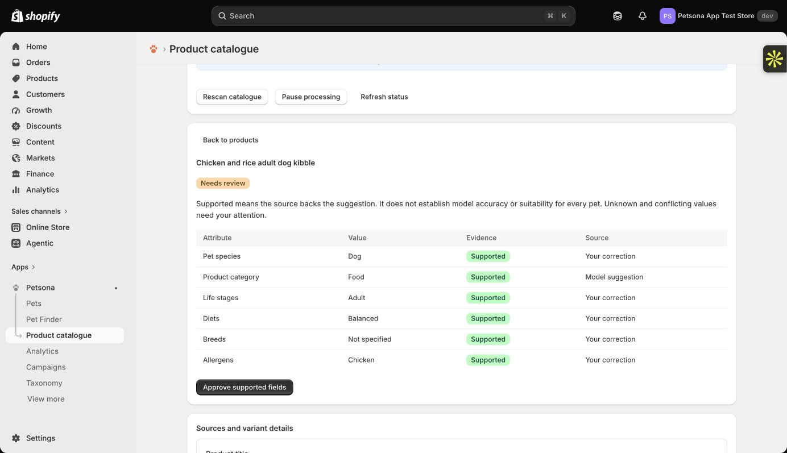
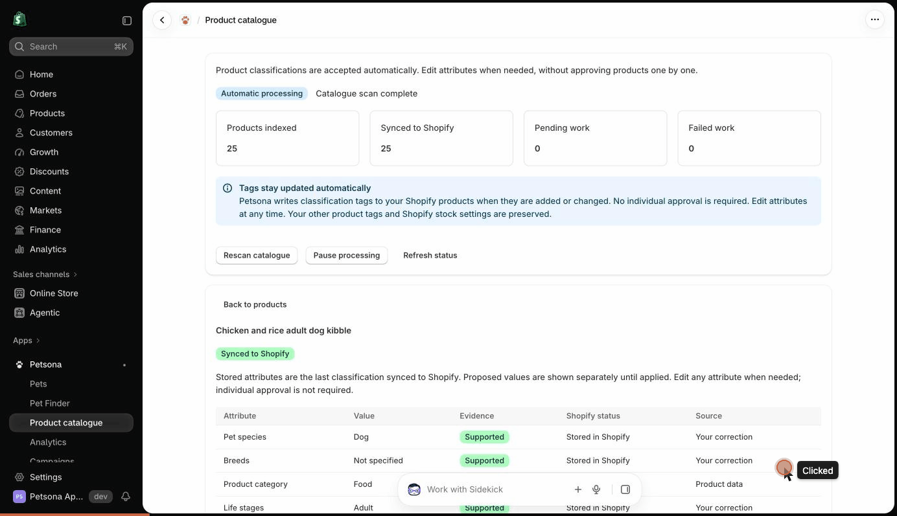

# Petsona Catalogue AI

Evidence-backed pet product classification with typed decision models (Jev and Laya), from the Petsona Shopify app by Rexin Dynamics. Submission for **AIBoomi Startup Weekend, Kochi, 23-24 October 2026**.

Give it a pet store's product and it tells the merchant, with the exact source sentence, which pet the product is for, what life stage, which allergens it contains, and what it does **not** know. A shopper with an allergic dog then only sees products that are safe to consider.

## Submission at a glance

| Item | Where |
| --- | --- |
| Event and team | AIBoomi Startup Weekend Kochi, solo team: Jerom Palimattom Tom, Rexin Dynamics |
| Repository | https://github.com/jeromtom/petsona-catalogue-ai |
| Run the AI slice locally | `npm install && npm test && npm run demo:all` (under a minute, no credentials needed) |
| Live product | [petsona.xyz](https://petsona.xyz) (overview and 25-second demo video), [shop.petsona.xyz](https://shop.petsona.xyz) (live pet-aware search across Shopify merchants), [admin.petsona.xyz](https://admin.petsona.xyz) (merchant app, Shopify login required) |
| Demo recording | [`docs/petsona-catalogue-demo.gif`](docs/petsona-catalogue-demo.gif): the merchant catalogue on the live development store, opening a product's evidence review (recorded 24 October 2026) |
| Pitch deck (6 slides) | [`docs/pitch-deck.pdf`](docs/pitch-deck.pdf), source in [`docs/pitch-deck.md`](docs/pitch-deck.md) |
| AI Impact Statement | [`AI-IMPACT-STATEMENT.md`](AI-IMPACT-STATEMENT.md) |
| Prior work and hack-window timeline | [`PRIOR-WORK.md`](PRIOR-WORK.md) |
| Architecture, guardrails, evaluation | [`docs/architecture.md`](docs/architecture.md), [`docs/guardrails-and-evaluation.md`](docs/guardrails-and-evaluation.md) |
| Licence and attributions | MIT ([`LICENSE`](LICENSE)), third-party notices in [`NOTICE.md`](NOTICE.md) |

## Problem statement

A pet store knows its shopper's name, address and card. It knows nothing about the pet. Product pages are free text: "chicken-free" is a marketing claim, "animal fat" hides its source, and a fish-shaped toy is not fish food. Merchants hand-tag thousands of SKUs or do not tag at all, and a parent of an allergic dog reads every label themselves.

## Users and context

- **Merchants** running pet stores on Shopify who want pet-aware discovery without a tagging project. They approve, correct and lock what the system proposes.
- **Shoppers** who save a pet profile once (species, breed, birthday, allergies) and want the store to show products that fit that pet.
- **Pets** with allergies, life-stage needs and sizing constraints, which the store must never guess about.

## Solution overview

```text
Shopify product text and images, manufacturer page, label photo (OCR)
  -> evidence spans with IDs
  -> deterministic extraction: candidate values + evidence IDs + conflicts
  -> one atomic typed question per value
  -> decision model (Jev 1.13.0 or Laya): supported / contradicted / unknown / conflicting + probabilities
  -> strict validation, spend ledger, idempotent plan hash
  -> merchant review: approve, correct, lock
  -> app-owned tags and metafields (petsona:species:dog, allergen_evidence)
  -> Pet Picks: deterministic eligibility filter, then an LLM may only re-order eligible products
```

The decision model is the point of the design. Jev and Laya are typed decision models: they take a state and closed questions and return a choice with a calibrated probability distribution in one forward pass. They never generate text, so there is nothing to parse and no invented ingredient can appear. Laya is open weight (Apache 2.0), which gives Petsona a self-hosting path. Full diagram and stage notes in [`docs/architecture.md`](docs/architecture.md).





## Setup and run

Requires Node.js 22 or newer.

```bash
npm install
npm test            # 115 tests: 77 contract tests, 38 catalogue tests
npm run demo:all    # three products through extraction and decision planning (dry run)
npm run demo:ocr    # label OCR text -> ingredient block -> allergen mapping
```

`npm run demo -- demo/samples/ocean-fish-adult-cat-food.json` prints the evidence spans, the deterministic proposals, the 19 typed questions that would go to the model, and what would reach the store. Without a key it stops before the model call and says so.

To make the live call, set one of the keys. Nothing else changes.

```bash
TYPESAFE_API_KEY=...    npm run demo -- demo/samples/ocean-fish-adult-cat-food.json   # Jev 1.13.0
AI_GATEWAY_API_KEY=...  npm run demo -- demo/samples/ocean-fish-adult-cat-food.json   # Laya via Vercel AI Gateway free alias (until 31 Oct 2026)
```

Excerpt of the dry run:

```text
2. Deterministic proposals (explicit-spans-v5+ingredients-2026-10-23.1)
  species           ["cat"]                 conflicting  evidence: description:0, description:1, description:3, productType:0
  category          "food"                  supported    evidence: title:0, productType:0
  lifeStages        ["kitten"]              conflicting  evidence: title:0, description:0, description:1
  allergens         ["chicken","grain","fish"] supported evidence: description:2
  allergensPossible ["beef"]                supported    evidence: description:2

5. What reaches the store
  automatically, with no validated acceptance policy: (nothing)
  after the merchant approves the supported fields: petsona:allergen:chicken, petsona:allergen:fish, petsona:allergen:grain, petsona:category:food
  Allergen absence is never inferred. It is published only from the merchant's explicit attestation.
```

"Not suitable for kittens" next to "adult cats" is reported as a conflict for the model and the merchant, not resolved silently. That is the behaviour we want.

## Models and data

| Model or service | Used for | Licence or terms | Version pinned |
| --- | --- | --- | --- |
| [Laya](https://github.com/NandhaKishorM/laya) (`convaiinnovations/laya`, 421M English, 322M multilingual) | Typed evidence verdicts, served through the Vercel AI Gateway free alias during the pilot | Apache 2.0, open weights | Tokenizer revision `7b928d82…`, SHA-256 verified |
| [TypeSafe Jev](https://docs.typesafe.ai/models) | Same verdicts from the hosted model; US$0.042 per million input tokens, free output | Commercial API | `jev-1.13.0` |
| Google Cloud Vision document text detection | Ingredient statements from the merchant's own label photos (off by default, at most three images, confidence 0.85 or higher) | Google Cloud terms | `vision-document-text-v1` |
| Groq-hosted `openai/gpt-oss-120b` (main app only) | Re-orders an already filtered Pet Picks shortlist of at most 20 products; drafts campaign copy | Groq API terms; weights Apache 2.0 | Not part of classification |

Data sources: the merchant's own Shopify product title, description, tags, variants and `cdn.shopify.com` images; manufacturer product pages fetched only for explicitly verified vendor domains under robots.txt with GTIN or exact SKU matching; a 410-product research corpus collected from 12 official brand feeds (not redistributed here). The classifier never receives pet or customer data. Sample products in `demo/samples/` are fictional.

## Evaluation and guardrails

In the code: four-way evidence status instead of yes/no; missing text is never absence; allergen absence only from a merchant attestation; unnamed animal sources recorded as "possibly present"; intended-species extraction that ignores recipe ingredients and toy shapes; instructions that treat product text as untrusted data; pinned model identity checked on every response; full probability distributions required; monthly spend ledger with no promotional-to-paid fallback; shared rate-limit admission; source and plan hashes for idempotency; merchant overrides that lock across refreshes.

Evidence so far: 115 tests here and over 1,500 unit tests in the main repository; a live shadow run on 3 October 2026 (20 products, 19 evaluated by Laya, zero cost, zero tags written in shadow mode); an active run on 4 October 2026 that classified a product with an empty description from its verified manufacturer page; one live false positive (fish as a species for cat food) caught and fixed with regression tests. Details and what is still unmeasured in [`docs/guardrails-and-evaluation.md`](docs/guardrails-and-evaluation.md).

## Known limitations and risks

- **No measured accuracy.** The research corpus has zero independently reviewed labels. Verdicts are shown as evidence status, not as safety or medical advice.
- **Provider window.** The Laya free alias ends on 31 October 2026. The plan is a self-hosted Laya service on Cloud Run or the paid Jev API; neither is switched on automatically.
- **One store so far.** Live runs happened on Petsona's development store with demonstration products.
- **English-first extraction.** Rules are English regular expressions; the multilingual Laya checkpoint is budgeted for but not evaluated.
- **OCR is off by default** and limited to the merchant's own images.
- **Manufacturer pages vary.** Enrichment covers two verified brand profiles today.

## Repository layout

```text
README.md, AI-IMPACT-STATEMENT.md, PRIOR-WORK.md, NOTICE.md, LICENSE
demo/            classify.ts (product -> verdicts), ocr-label.ts, samples/
src/contracts/   shared data contracts: classification taxonomy, ingredient-to-allergen rules, eligibility, fixtures
src/catalogue/   extraction, decision planning, OCR evidence parsing, allergen evidence, presentation (+ tests)
src/PROVENANCE.md  exact monorepo commit and the two mechanical changes made for this snapshot
docs/            architecture, guardrails and evaluation, pitch deck (md, html, pdf), screenshots
```

## Team

Jerom Palimattom Tom, Founder and CEO, Rexin Dynamics Private Limited, Kochi. Solo participant. Contact: jerom@rexindynamics.com.

## Licence

MIT, Rexin Dynamics Private Limited, 2026. Third-party components and their licences are listed in [`NOTICE.md`](NOTICE.md).
